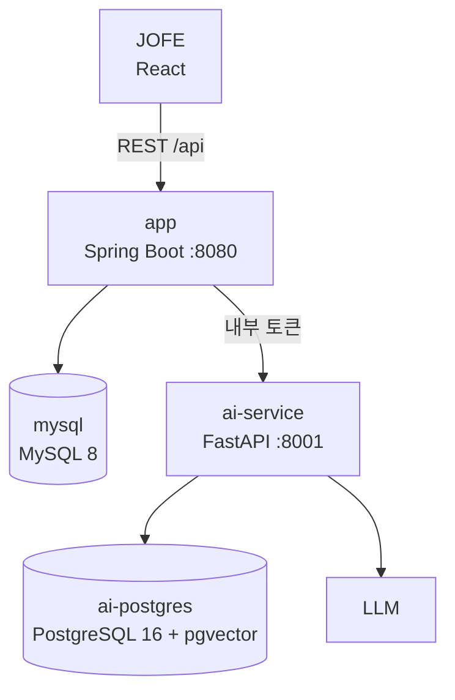

# 진로온 (JinroOn) — Backend

흥미·활동·학습 응답을 근거로 먼저 탐색해볼 전공을 제안하는 **진로온**의 백엔드입니다.
Spring Boot API, 전공 탐색 진단 엔진, 데이터 카탈로그, AI 서비스(`ai-service/`)가 이 리포지토리에 함께 있습니다.

- 서비스 소개: [JinroOn 조직 프로필](https://github.com/JinroOn)
- 프론트엔드: [JinroOn/JOFE](https://github.com/JinroOn/JOFE)

## 목차

- [구성](#구성)
- [기술 스택](#기술-스택)
- [폴더 구조](#폴더-구조)
- [전공 탐색 진단](#전공-탐색-진단)
- [로컬 개발 환경 세팅](#로컬-개발-환경-세팅)
- [탐색 진단 켜기](#탐색-진단-켜기)
- [테스트 · CI · 배포](#테스트--ci--배포)
- [기존 진단 (사용하지 않음)](#기존-진단-사용하지-않음)
- [브랜치 전략과 주의사항](#브랜치-전략과-주의사항)

## 구성



| 서비스 | 역할 |
|---|---|
| `app` (Spring Boot) | 인증, 회원, 전공, 공지, **전공 탐색 진단**(세션 · 문항 발행 · 답변 · 후보 계산 · 결과), 관리자 API |
| `mysql` | 회원 · 전공 · 탐색 카탈로그 · 세션 · 답변 · 결과 |
| `ai-service` (FastAPI · LangChain) | 확정된 결과와 승인된 자료를 근거로 전공 설명 · 상담 · 12주 계획 생성 |
| `ai-postgres` | 전공 RAG 청크(pgvector), AI 작업 기록 |

전공 후보와 점수는 **Spring Boot가 규칙으로 계산**합니다. AI 서비스는 계산된 결과를 설명하는 역할만 하며, 꺼져 있어도 진단과 결과는 동작합니다.

## 기술 스택

| 구분 | 사용 기술 |
|---|---|
| API | Java 17, Spring Boot 4, Spring Security(JWT), Spring Data JPA, Validation, Mail, springdoc-openapi |
| DB | MySQL 8, Flyway(`exploration_*` 테이블), Hibernate `ddl-auto`(기존 테이블) |
| AI | Python, FastAPI, LangChain, langchain-openai, PostgreSQL 16 + pgvector, Alembic |
| 인프라 | Docker Compose, GitHub Actions, AWS EC2, Terraform |

## 폴더 구조

```text
JOBE/
 ├─ src/main/java/com/jinroon/jobe/
 │   ├─ domain/
 │   │   ├─ exploration/      # ★ 전공 탐색 진단
 │   │   │   ├─ api/          #   /api/exploration/v1 컨트롤러
 │   │   │   ├─ service/      #   세션 · 단계 진행 · 실행 정책
 │   │   │   ├─ branching/    #   다음 문항 결정
 │   │   │   ├─ scoring/      #   관심 · 활동 · 학습 점수 계산
 │   │   │   ├─ candidate/    #   후보 전공군 · 전공 선정
 │   │   │   ├─ catalog/      #   카탈로그 적재 · 검증
 │   │   │   ├─ comparison/ activity/ support/ history/ sharing/
 │   │   │   ├─ ai/ consultation/ plan/ context/ profile/ display/
 │   │   │   └─ review/       #   관리자 검토 · 활성화
 │   │   ├─ auth/ user/ major/ notice/ dashboard/
 │   │   └─ diagnosis/ result/ plan/ consultation/   # 기존 진단 (차단됨)
 │   └─ global/               # 보안 · 설정 · 공통 응답
 ├─ src/main/resources/db/migration/mysql/   # Flyway V1~V18
 ├─ ai-service/               # FastAPI AI 서비스 (자세한 내용은 ai-service/README.md)
 ├─ datasets/
 │   ├─ exploration/          # 문항 · 선택지 · 전공 매핑 · 규칙 원본 + manifest.json(SHA-256)
 │   ├─ activities/           # 탐색 활동 카탈로그 · 전공별 검토본
 │   ├─ majors/               # 전공별 *.service.json 94개
 │   ├─ rag/per-major/        # 전공 RAG용 JSONL 94개
 │   └─ exploration-validation/  # 계약 사례 · 도달성 시험 입력
 ├─ scripts/                  # 데이터 준비 검증 · 배포 스크립트
 └─ docker-compose*.yml       # 개발 · 로컬 · 테스트용 구성
```

## 전공 탐색 진단

### 흐름

```text
POST /sessions → GET /sessions/{id}/next → PUT /sessions/{id}/answers/{issuedId} … → POST advance
→ (2 · 3단계 반복) → POST /sessions/{id}/complete → 결과 · 비교 · 활동 · AI 설명 · 상담 · 계획
```

다음 문항과 단계는 서버가 정합니다. 응답의 `nextAction`(`ANSWER` · `NEXT` · `ADVANCE` · `COMPLETE`)이 프론트가 할 일을 알려 줍니다.

### 주요 API (`/api/exploration/v1`)

| 구분 | 엔드포인트 |
|---|---|
| 회차 | `POST /sessions` · `GET /sessions` · `GET /sessions/{id}` · `POST /sessions/{id}/abandon` |
| 진행 | `POST /sessions/{id}/next` · `PUT /sessions/{id}/answers/{issuedId}` · `POST /sessions/{id}/advance` · `PUT /sessions/{id}/presentation` |
| 완료 · 결과 | `POST /sessions/{id}/complete` · `GET /sessions/{id}/result` · `GET /results/{id}` · `GET /results/{id}/candidates` |
| 결과 활용 | `GET /results/{id}/comparison` · `GET /results/{id}/activities` · `POST /results/{id}/support` · `GET /majors/{code}/profile` |
| AI | `/results/{id}/majors/{code}/explanation` · `POST /results/{id}/consultations` · `POST /consultations/{id}/messages` · `POST /results/{id}/plans` · `GET /plans/{id}` |
| 공유 · 이력 | `POST /results/{id}/share` · `POST /results/{id}/share/revoke` · `GET /shared-results/{token}` · `/history` |
| 관리자 | `/api/admin/exploration/catalogs` · `/reviews` · `/activations` |

전체 명세는 실행 후 Swagger UI(`/swagger-ui/index.html`)에서 볼 수 있습니다.

### 추천 규칙

규칙은 `datasets/exploration/ruleset-v1-6.json`(`RULESET_V1_6_IMPLEMENTATION_CANDIDATE`)에 있습니다.

- 점수에 쓰는 문항 역할은 `CANDIDATE_TOPIC`(관심) · `CANDIDATE_ACTIVITY`(활동) · `CANDIDATE_LEARNING`(학습) 세 가지뿐입니다.
- 응답 점수는 0 · 25 · 50 · 75 · 100이고, `UNKNOWN` · `NO_EXPERIENCE` · 미출제는 평균에서 뺍니다.
- 전공 점수는 관심 0.62 + 활동 0.28 + 학습 0.10(학습 없음: 0.72 + 0.28)이며, 빠진 요소는 남은 비중을 다시 맞춥니다.
- 회차를 시작할 때 문항 · 선택지 · 전공 매핑 · 규칙 버전을 고정하고, 결과는 완료 후 바뀌지 않습니다.
- 같은 입력과 같은 버전이면 같은 질문 순서와 결과가 나옵니다. 동점은 전공 코드 오름차순입니다.

임계값은 구현을 위해 정한 후보 값이며, 파일럿과 전문가 검수로 검증하는 단계는 진행하지 않았습니다.

## 로컬 개발 환경 세팅

### 실행 전 준비
> .env, application-dev.yml 파일은 노션 환경 변수란에 저장되어 있습니다.

**1. ai-service/.env 파일 생성**

git에 포함되지 않으므로 직접 생성해야 합니다.

```
INTERNAL_SERVICE_TOKEN=dev-internal-token
MOCK_MODE=true
```

> `MOCK_MODE=true` 설정 시 실제 LLM API 호출 없이 테스트용 응답이 반환됩니다.

**2. Spring Boot 빌드**

```bash
./gradlew bootJar -x test
```

### 실행

```bash
docker-compose up -d
```

### 접속 주소

| 서비스 | 주소 |
|---|---|
| Spring Boot API | http://localhost:8080 |
| Swagger UI | http://localhost:8080/swagger-ui/index.html |
| AI 서버 | http://localhost:8001 |

### 로컬 회원가입 메일 확인 (Mailpit)

로컬에는 실제 메일 서버(SMTP)가 없어 회원가입·비밀번호 재설정 인증 메일을 보낼 수 없습니다.
Mailpit을 띄우고 백엔드를 `mailpit` 프로필로 실행하면, 메일이 외부로 나가지 않고 Mailpit으로 들어옵니다.

```bash
docker compose -f docker-compose.yml -f docker-compose.local.yml up -d mailpit
```

- 백엔드 실행 프로필에 `mailpit`을 추가합니다. 예: `SPRING_PROFILES_ACTIVE=dev,mailpit`
- 받은 메일(인증번호)은 http://localhost:8025 에서 확인합니다.
- `mailpit` 프로필은 `prod` 프로필과 함께 켜면 시작되지 않습니다.

### 주의사항

볼륨이 이미 존재하면 초기 데이터가 생성되지 않습니다.
처음 실행하거나 데이터를 초기화하려면 아래 순서로 실행하세요.

```bash
docker-compose down -v   # 볼륨까지 삭제
docker-compose up -d
```

### 자주 쓰는 명령어

```bash
# 실행
docker-compose up -d

# 중지
docker-compose down

# 로그 확인
docker-compose logs -f

# 특정 서비스 로그
docker-compose logs -f app

# 재빌드 후 실행
docker-compose up -d --build

# 볼륨까지 삭제 (DB 초기화)
docker-compose down -v
```

## 탐색 진단 켜기

기본값으로는 `/api/exploration/v1`이 모두 꺼져 있습니다(404). 아래를 **모두** 만족해야 회차를 시작할 수 있습니다.
`application.yml`은 고치지 않고 환경변수로 넘깁니다.

| 환경변수 | 값 | 설명 |
|---|---|---|
| `EXPLORATION_ENABLED` | `true` | 꺼져 있으면 경로 전체가 404 |
| `EXPLORATION_RUN_MODE` | `DEV` | 기본값 `PUBLIC` · `PILOT`는 승인 절차가 없어 항상 503 |
| `SPRING_PROFILES_ACTIVE` | `dev,exploration-dev` | `exploration-dev` 필수, `prod` · `production`이 있으면 안 됨 |
| `EXPLORATION_DEV_USER_IDS` | `1,2` 또는 `*` | 허용할 사용자 id(쉼표 구분). 정확히 `*`이면 로그인한 모든 사용자 |
| `EXPLORATION_CATALOG_LOAD_ON_STARTUP` | `true` (최초 1회) | 카탈로그 적재. `EXPLORATION_CATALOG_DRY_RUN=true`면 검증만 함 |
| `EXPLORATION_RULESET_VERSION` | (기본값 사용) | 적재된 규칙 버전과 정확히 같아야 함. 기본 `RULESET_V1_6_IMPLEMENTATION_CANDIDATE` |

후속 기능은 따로 켭니다. 기본값은 모두 `false`입니다.

| 환경변수 | 기능 |
|---|---|
| `EXPLORATION_ACTIVITY_LOAD_ON_STARTUP` | 탐색 활동 카탈로그 적재 (`EXPLORATION_ACTIVITY_DRY_RUN` 기본 `true`) |
| `EXPLORATION_EVIDENCE_ENABLED` | AI가 쓰는 승인 근거 자료 |
| `EXPLORATION_MAJOR_EXPLANATION_ENABLED` | 전공별 AI 설명 |
| `EXPLORATION_JOBS_ENABLED` | 상담 · 계획 생성 작업 큐 |
| `EXPLORATION_MODEL_EXECUTION_ENABLED` | 실제 LLM 호출 (`EXPLORATION_MOCK_EXECUTION_ENABLED`는 모의 실행) |
| `EXPLORATION_SHARING_ENABLED` | 결과 공유 (비로그인 조회는 서버 로컬에서만 열림) |

모델은 `LLM_MODEL`(기본 `gpt-6-luna`)을 백엔드와 AI 서비스가 같이 읽습니다.
탐색 진단만 다른 모델을 쓰려면 `EXPLORATION_LLM_MODEL`을 양쪽에 같은 값으로 넣습니다.

> - Flyway 마이그레이션은 MySQL 전용 문법(생성 열 · JSON · CHECK)이라 다른 DB에서는 실행되지 않습니다.
> - 카탈로그 원본을 바꾸면 `manifest.json`의 해시를 갱신하고 데이터 버전도 올려야 합니다. 같은 버전에 다른 내용이 들어오면 적재를 거부합니다.
> - CORS 기본 허용 출처는 `https://jinro-on.vercel.app`, `http://localhost:5173`, `http://localhost:4173`입니다(`CORS_ALLOWED_ORIGINS`).

## 테스트 · CI · 배포

### 테스트 실행

통합 테스트는 개발 DB(`jobe`)가 아닌 전용 테스트 DB(`jobe_test`, 포트 13307)만 사용합니다.

```bash
docker compose -f docker-compose.test.yml up -d --wait
```

```bash
JOBE_TEST_DATABASE_URL='jdbc:mysql://127.0.0.1:13307/jobe_test?allowPublicKeyRetrieval=true&useSSL=false&serverTimezone=Asia/Seoul' \
JOBE_TEST_DATABASE_USERNAME=root JOBE_TEST_DATABASE_PASSWORD=jobe-test-only ./gradlew test
```

- 테스트 DB는 메모리에 저장되므로 컨테이너를 내렸다 올리면(`down` → `up`) 비워집니다.
- 테스트가 오류 없이 멈추면 테스트 DB 용량을 확인하고 컨테이너를 다시 올리세요.

### CI · 배포

| 워크플로 | 실행 시점 | 내용 |
|---|---|---|
| `.github/workflows/ci.yml` | `develop` · `main` 대상 PR, `develop` push | AI 서비스 pytest · Alembic, `scripts/verify_exploration_preparation.py`, `./gradlew test`(MySQL 8 컨테이너) |
| `.github/workflows/deploy.yml` | `main` push | 테스트 후 데모 서버로 배포. DB 변경이 있으면 `allow_migration`으로 수동 허용 |

## 기존 진단 (사용하지 않음)

새 진단은 전공 탐색 진단(`/api/exploration/v1`)만 사용합니다. 기존 진단의 `diagnosis`·`result`·`plan`·`consultation` 코드와 데이터는 남겨 두고 연결만 끊었습니다.

- `/api/diagnoses`, `/api/results`, `/api/plans`, `/api/consultations`는 `410 LEGACY_DIAGNOSIS_RETIRED`를 반환합니다.
- 진단 이력과 대시보드 요약은 탐색 진단만 다룹니다.
- 기존 진단 문항은 자동으로 등록하지 않습니다.

다시 켜야 할 때는 `LEGACY_DIAGNOSIS_ENABLED=true`로 실행합니다. 이때도 새 회차 시작(`POST /api/diagnoses/sessions`)은 410입니다.

## 브랜치 전략과 주의사항

`feature` → `develop` (기본) → `main` (배포)

- `application.yml`은 수정하지 않음
- `application-dev.yml`: 로컬 개발용
- `application-prod.yml`: 배포용 (git에 포함되지 않음)

## 남은 과제

- AI 전공 설명의 2차 품질 평가와 약한 연결 보강 ([#152](https://github.com/JinroOn/JOBE/issues/152), [#166](https://github.com/JinroOn/JOBE/issues/166))
- 운영 환경에서 탐색 진단을 열 범위와 결과 공유 범위 결정 (`PUBLIC` · `PILOT` 모드 승인 절차)
- 문항 · 임계값 · 전공 매핑의 파일럿 · 전문가 검수 (`domain_review_status`는 모두 `PENDING`)

## 라이선스

[MIT](LICENSE) © 2026 JinroOn
